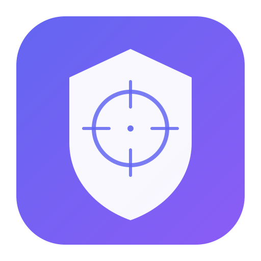

<p align="center">
  
</p>

<h1 align="center">ThreatCaddy</h1>

<p align="center">
  <strong>Local-first threat investigation workspace for security analysts.</strong><br/>
  Notes, IOCs, timelines, graphs, CaddyAI, autonomous agents, and optional team collaboration, with investigation data stored in your browser.
</p>

<p align="center">
  <a href="https://github.com/peterhanily/threatcaddy/blob/main/LICENSE"></a>
  
  
  
  
  
  <a href="https://github.com/peterhanily/threatcaddy/releases/latest"></a>
</p>

<p align="center">
  <a href="https://threatcaddy.com">threatcaddy.com</a> &nbsp;|&nbsp;
  <a href="https://threatcaddy.com/?demo=1">Live Demo</a> &nbsp;|&nbsp;
  <a href="extension/README.md#install--chrome">Browser Extension</a>
</p>

---

## Why ThreatCaddy?

Most investigation tools lock your data in a cloud you don't control, cost per seat, and force you into rigid workflows. ThreatCaddy is different:

- **Local-first** — Investigation data is stored in your browser's IndexedDB. No account is required for local use; optional sync, AI, enrichment and backup features can send data to configured services.
- **Zero setup** — Open the URL and start working. No install, and no team server needed for local use.
- **Optional team server** — When you need collaboration, spin up a Docker container. Per-investigation sync lets you choose what stays local and what gets shared. Some details remain device-only; keep a [separate full backup](docs/backup-recovery.md#team-sync-and-backup-cover-different-data).
- **Encryption at rest** — Optional AES-256-GCM encryption with PBKDF2 key derivation protects covered local content fields while locked; it does not encrypt the whole browser profile or provide end-to-end team sync.
- **Works offline** — Download a standalone HTML file that runs from `file://`. It runs only when opened from a file; served from a web server, it shows a notice instead.
- **AI that works for you** — From a conversational assistant to a full autonomous multi-agent security team, CaddyAI and AgentCaddy meet you where you are.

## Quick Start

**Try it now:** [threatcaddy.com/?demo=1](https://threatcaddy.com/?demo=1) loads a sample investigation with a guided walkthrough.

**Download a release:** [Latest stable downloads](https://github.com/peterhanily/threatcaddy/releases/latest) provide the tested standalone HTML, browser-extension archives, `release-manifest.json` (with the source revision) and `SHA256SUMS`. Client and server 2.1.0 add [Identities](#identities): the people, organizations, systems and accounts in an investigation; the team server adds one database migration, and there is no downgrade. The extension has its own version, currently 1.1.5; ThreatCaddy uses only 1.1.3 or later. Read the [2.1.0 upgrade and channel notes](docs/releases/v2.1.0.md) before updating. Browser-store publication and upgrades of running team servers are separate from these downloads.

**Self-host the client:**

Use Node **24.22.3** and pnpm **10.29.1** (npm **11.19.0** for the server and extension). See [development and verification](docs/development-verification.md) for the complete setup and checks.

```bash
pnpm install --frozen-lockfile
pnpm dev          # Dev server at localhost:5173
```

**Deploy a team server:**

```bash
cp .env.example .env   # From the repository root; fill the required values first
docker compose up -d   # Starts Hono server + PostgreSQL
```

Set `POSTGRES_PASSWORD`, a stable `BOT_MASTER_KEY`, the Ed25519 `JWT_PRIVATE_KEY` / `JWT_PUBLIC_KEY` pair, and an exact `ALLOWED_ORIGINS` list before starting. Compose derives `DATABASE_URL`; direct server execution uses [server/.env.example](server/.env.example) instead. Preserve encryption keys across restarts and restores. Follow the [deployment guide](docs/deployment.md) for key generation, TLS and first-admin setup.

---

## Features

### Notes & Editor

- **Markdown editor** with live preview, split view, and syntax highlighting for 20+ languages
- **Wiki-links** — Type `[[note title]]` to link between notes with autocomplete and broken-link indicators
- **Slash commands** — `/` menu with formatting, threat intel templates (IOC tables, MITRE references, TLP headers), and quick inserts
- **Note sub-folders** — Organize notes into a hierarchy via drag-to-folder; folders are first-class notes with `isFolder` set
- **Note annotations** — Timestamped comments on any note
- **Defang/Refang toggle** — Preview network IOCs in defanged form (`hxxps://`, `example[.]com`)
- **Open markdown files** — Open Markdown or `.txt` files via `Ctrl+O` / `Cmd+O`, drag-and-drop, or the New menu. File name, size, and last-modified date are captured in the title. IOCs are auto-extracted on import. Files are limited to 5 MiB each, with at most 20 pending imports; launch requests wait for an unlocked workspace without reading their contents
- **Quick capture** — Clip articles, bookmarks, code snippets, and meeting notes with 15+ built-in templates
- **Note templates** — 15 built-in templates (host details, malware analysis, phishing reports, threat actor profiles, and more). Create, edit, and save your own. Save any note as a reusable template.

### Investigation Playbooks

- **Built-in playbooks** — 6 pre-built playbooks: Incident Response, Phishing Investigation, Malware Analysis, Threat Hunt, Data Breach, and Vulnerability Assessment
- **Custom playbooks** — Create your own with ordered steps that auto-populate investigations with tasks and notes
- **One-click instantiation** — Start a new investigation from a playbook and get a complete workspace: folder, timeline, tasks with phases/priorities, and pre-filled notes from templates

### Task Management

- Priorities, due dates, and statuses with list and kanban views
- Threaded comments on tasks

---

### CaddyAI

Human-driven conversational AI assistant with a deep toolset for threat investigation.

- **Multi-provider** — Anthropic, OpenAI, Google Gemini, Mistral and local endpoints such as Ollama, LM Studio and vLLM. Select an available model and configure credentials in Settings; provider availability and model names can change.
- **63 tools** — 51 core tools to search, read, create, and update all entities, including identities; 7 delegation tools for Lead Analyst coordination; 5 executive tools for CISO/Chief of Staff. Covers IOC extraction, URL fetching, report generation, and cross-investigation analysis
- **Slash commands** — `/fetch`, `/search`, `/note`, `/task`, `/iocs`, `/summary`, `/timeline`, `/report`, `/triage`, `/graph`, `/link`
- **Customizable system prompt** — Editable in Settings with CTI/IR tradecraft baked into the default (MITRE ATT&CK, Diamond Model, Kill Chain, Pyramid of Pain, estimative language, TLP/PAP)
- **Persistent threads** with auto-generated titles; stays active in the background when switching tabs
- **Approvals and data flow** — CaddyAI asks before it opens a web page, uses a skill, changes agents, writes into another investigation, or reads other investigations from an investigation that can sync. YOLO covers only changes inside the conversation's investigation and built-in vendor lookups, and Plan mode only reads (inside an investigation, only that one). AI working in an investigation that can sync, including a team investigation viewed without syncing it, does not list, search or read local-only investigations, and turning off local-only (Cloud Sync or Keep on this device) for an investigation that holds AI-written content asks first. **Settings → AI → Where AI data goes** shows the route AI requests take (local model, browser extension or team server); a local model with an endpoint is called directly (chat titles and conversation summaries still go to it through the extension), and with no route nothing is sent

---

### AgentCaddy — Autonomous Multi-Agent System

Deploy a team of AI analysts that run autonomously in the background, enriching data, building timelines, hunting threats, and briefing stakeholders — while you keep working.

These agents run in the open client. Server-side AgentCaddy handoff and the legacy server integration runner are unavailable; saved definitions and history are retained. Client integration execution and team template sharing remain supported.

#### The 18 Built-in Analyst Profiles

| Role | Profile | Focus |
|------|---------|-------|
| 🏛️ CISO | Executive | Strategic risk, business impact, resource decisions |
| 📋 Chief of Staff | Executive | Operational coordination, blocker identification, progress |
| 👑 Lead Analyst | Leadership | Case orchestration, task delegation, quality review |
| 🔍 IOC Enricher | Specialist | VirusTotal, AbuseIPDB, Shodan enrichment |
| 📅 Timeline Builder | Specialist | Date extraction, ATT&CK tactic mapping, narrative creation |
| 🧠 Hypothesis Writer | Specialist | Falsifiable working theories — claim, evidence (for/against), confidence, how-to-test |
| 🎯 Threat Hunter | Specialist | Hypothesis-driven hunting, behavioral pattern detection |
| 🦠 Malware Analyst | Specialist | Hash analysis, C2 extraction, family identification |
| 🌐 Network Forensics | Specialist | Network IOCs, C2 infrastructure, lateral movement |
| 🔬 Digital Forensics | Specialist | Artifacts, chain of custody, evidence integrity |
| 🛡️ Vulnerability Analyst | Specialist | CVE research, exploitability, patch prioritization |
| ⚖️ Legal Counsel | Observer | Breach notification, evidence admissibility, regulatory exposure |
| 📜 Compliance Officer | Observer | GDPR, HIPAA, PCI-DSS, SOX, NIST framework mapping |
| 📢 Communications Lead | Observer | Customer notification, press statements, PR messaging |
| 🏢 Business Continuity | Observer | Operational impact, RTO/RPO, recovery actions |
| 🔗 Pattern Hunter | Cross-case | Shared IOCs, TTPs, campaign connections across investigations, when deployed in a local-only investigation |
| 📝 Reporter | Specialist | Structured report generation, IOC stats, timeline coverage |
| 🛡️ Forensicate Scanner | Specialist | Basic check of investigation content for common prompt-injection patterns; the check runs on this device, and like every agent it sends what it reads to your AI model |

**Executives** can propose spawning, defining and dismissing agents; each proposal waits for your approval. **Observers** have read-only access to technical entities. **Pattern Hunter** compares investigations only from a local-only investigation; in one that can sync, its cross-investigation tools are off. No other built-in agent reads or changes other investigations; a custom profile that lists the cross-investigation tools, such as a duplicated Pattern Hunter, behaves like Pattern Hunter.

#### How It Works

- **Parallel execution** — Up to 5 deployments run concurrently via `Promise.allSettled`; falls back to serial for local LLMs. Each deployment has its own audit thread
- **Policy controls** — Auto-approve toggles for reads, enrichment, fetches, creates and changes, plus per-agent allowed tool lists. An investigation's saved toggles limit every agent deployed in it; an agent's own settings can only be stricter. Automatic fetches reach only fixed reference sites (NVD, CVE, CWE, MITRE ATT&CK, CISA, FIRST), and automatic enrichment runs only built-in vendor lookups. Other web pages, skills, agent changes, and writes or outbound calls taken from reply text always need approval, and calls into other investigations are refused (Pattern Hunter's comparisons aside), whatever the toggles. Lead and executive agents delegate and review tasks inside the investigation without approval, whatever the toggles. "Approve all" runs routine actions inside the investigation only
- **Agent Meetings** — Trigger a round-robin discussion between deployed agents (`call_meeting`). Produces structured meeting minutes saved as a Note
- **Supervisor** — Global cross-investigation agent running on a timer. Identifies shared IOCs, stale cases, and emerging patterns; keeps its findings in a local-only "CaddyAgent Supervisor" investigation. Its writes into other investigations wait for approval as proposals that carry a fixed note rather than its reasoning, and it cannot reach the network or change agents
- **Handoffs & Shift States** — Agents are either `active` or `resting`. Shift changes trigger a handoff call where the outgoing agent briefs the incoming one
- **Adaptive scheduling** — An investigation whose agents' actions mostly wait for review runs its cycles half as often (no success-based speed-up); after an error, its agents retry after 1, 2 and 4 minutes (twice that while slowed down), then stop. Only the agent with a pending proposal pauses
- **Agent Souls** — Executives accumulate persistent cross-investigation memory: `reflect_on_performance` proposes a lesson that waits for your approval, and `read_soul` reads them back. An approved dismissal adds a dated lesson, without the dismissal's text, to the dismissed agent's soul
- **War Bridges** — Emergency all-hands meetings triggered by critical findings (`declare_war_bridge`); escalates to CISO immediately
- **Agent Metrics** — Each deployment tracks cycles, tool calls, and token usage

#### Agent Hosts — External Skills

REST endpoints that expose skills through `GET /skills` and `POST /execute` (see [agent hosts](docs/agent-hosts.md)):

- A local LLM endpoint can still offer skills: **Settings → AI → Discover Skills** lists them as `local:<skill>` tools
- Named hosts (`host:<name>:<skill>`) can no longer be added or edited. Hosts configured in an earlier version are listed under **Settings → AI → Where AI data goes** with Remove; they must use https (plain http only on localhost)
- Every skill call that CaddyAI or an agent makes needs approval, whatever action class the host declares. Plan mode, the supervisor and the agent bridge do not use skills

---

### Threat Intelligence & Analysis

- **IOC extraction** — Auto-extract IPv4, IPv6, domains, URLs, emails, hashes (MD5/SHA-1/SHA-256), CVEs, MITRE ATT&CK IDs, YARA rules, Sigma rules, and file paths
- **Standalone IOCs** — Manage IOCs with type, confidence, subtypes, analyst notes, attribution, and classification
- **IOC relationships** — Many-to-many links with typed, directional relationships (e.g. domain "resolves-to" IP, hash "exploits" CVE)
- **Entity graph** — Interactive force-directed graph of IOCs, notes, tasks, timeline events and identities with drag-to-link, filtering, and multiple layouts, including a Focus layout centred on one node
- **IOC dashboard** — Aggregate stats: type/confidence distribution, top actors, timeline, frequency tables
- **TLP/PAP classification** — Traffic Light Protocol and Permissible Actions Protocol levels on entities and investigations
- **Export** — JSON, CSV (grouped or flat), STIX 2.1 bundles; push to OCI object storage
- **Evidence import** — PDF, Word, RTF, Excel, CSV, JSON, XML, logs, text and screenshots: up to 20 files and 50 MiB per import, 25 MiB per file. Parsing runs in a cancellable worker; very large documents import partially with a warning, unreadable or encrypted Office files import as metadata only, and decompression is bounded: oversized parts are cut, while archives with too many entries, too much compressed data or sizes that do not match their contents reject the batch without saving anything

### Identities

- **People, organizations, systems and accounts** — An Identities view for one investigation or all of them: an A–Z list with search and type, contact and status filters, a profile with details, a status (compromised, contained, suspicious, cleared), a classification and connections that read correctly from both sides ("reports to" and "manages"), plus org charts. Merge and delete ask first, and trashed identities can be restored from Trash
- **Private details** — Details labelled as phone numbers, street addresses, birth dates, passport or national ID numbers and similar start out private. The rule reads common spreadsheet headers in English and the main European languages (`MobilePhone`, `StreetAddress`, `Telefonnummer`), while mailbox, network and attacker addresses (email, IP, C2) stay public. The Data Import preview has a Private choice for each column, and any detail can be made private or public later. Private details are masked until you choose Show, never shown while screensharing, left out of the Identities CSV export unless you tick them, and never sent to AI. They are encrypted at rest when local encryption is on. Backups and investigation exports are full copies and include them, and they sync with the investigation like other content; the team server keeps earlier revisions (see [backup and recovery](docs/backup-recovery.md))
- **Linked across the investigation** — A timeline event's Actor and Assets, `@Name` mentions in notes, and IOCs whose value is an identity's detail link to its profile. A name not yet in Identities can be added, linked to an existing identity as another name, or ignored on this device. Each profile lists the events, notes and IOCs that name it, also in Chinese, Japanese, Korean and Thai text. "Not yet in Identities" offers the names on the timeline (Actor and Assets), in IOC attribution and in email IOCs that match no identity; a name found as an Actor or an attribution can be tracked as a threat actor instead
- **Import, export, graph and reports** — Import from CSV or JSON in Data Import (a name already in the investigation is filled in, never duplicated; types, statuses and connections are read in English or the interface language); CSV export that is safe to open in a spreadsheet; identity nodes and connections in the entity graph; grouping by identity in the MITRE report and heatmap; an "Affected people and systems" source in Products; global search; and a Dashboard "Compromised identities" tile
- **AI** — CaddyAI and agents can search, read, create and update identities and connect them, and you can mention one in chat with `@identity:`. Private details never reach a model. An agent's identity change always waits for your approval and is never included in "Approve all"; the Legal Counsel, Compliance Officer and Communications Lead agents see only names, types and statuses
- **Compatibility** — Identities sync only with a team server that supports them: an older server leaves them on the device and the sync status says so, and older ThreatCaddy clients on a new server carry on without them. A backup that contains identities, and any encrypted backup made by this version, can only be restored by a version that has them

### Timeline & Whiteboard

- **Incident timeline** — Map events to MITRE ATT&CK tactics with timestamps, confidence, and linked IOCs
- **Multi-timeline support** — Per-investigation timelines with dedicated views
- **Timeline map** — Geolocated events on an interactive Leaflet map with clustered markers
- **Smart data import** — Paste CSV, TSV, JSON, or NDJSON from SIEMs and EDR tools; auto-detect format, auto-map columns (Splunk, CrowdStrike, Elastic)
- **Whiteboards** — Freeform drawing with Excalidraw integration. Web embeds are not loaded: each becomes a rectangle that keeps its link
- **Activity log** — Track all actions across notes, tasks, timeline, and IOCs

### Organization

- **Investigations** — Color-coded folders with active/closed/archived lifecycle, closure resolutions, scoped entity counts, and bulk operations
- **Per-investigation sync** — Toggle cloud sync per investigation; mark sensitive cases as local-only
- **Entity cross-linking** — Link notes, tasks, and timeline events to each other
- **Tags** — Color-coded tags with rename and delete
- **Full-text search** — Instant search across all entity types with saved searches and investigation-scoped filtering
- **Unified trash & archive** — Manage deleted and archived items in one view with 30-day auto-delete

### Security & Backup

- **Encryption at rest** — Passphrase-based AES-256-GCM via PBKDF2 (600k iterations) with configurable session duration and recovery phrase
- **Cloud backup** — OCI bucket/prefix pre-authenticated URLs and Azure container SAS URLs; signed single-object S3/GCS URLs are not supported by the generated-key uploader. See [supported cloud destinations](docs/backup-recovery.md#supported-cloud-destination-urls).
- **Export & import** — Full JSON backup/restore; per-investigation export; includes note templates and playbooks

### Team Server

- **Docker deployment** — `docker compose up` for Hono + Node.js server and PostgreSQL
- **Authentication** — Ed25519 JWT auth with user roles (admin, analyst, viewer)
- **Real-time sync** — Push/pull synchronization with version tracking, conflict detection, and WebSocket live updates
- **Presence** — See who's online and what they're viewing
- **Team feed** — Posts, reactions, threaded replies, mentions, and notifications
- **Investigation sharing** — Invite members with per-investigation roles (owner, editor, viewer)
- **Audit trail** — Server-side activity logging
- **Server-side LLM** — Proxy LLM requests through the server with shared API keys
- **File storage** — Upload and share files within investigations

---

### Browser Extension

Install version 1.1.5 from the [GitHub release](https://github.com/peterhanily/threatcaddy/releases/latest): download `threatcaddy-chrome.zip` or `threatcaddy-firefox.zip`, unzip it into a new, empty folder and load it with the [install steps](extension/README.md#install--chrome) (in Chrome, Developer mode and **Load unpacked**; in Firefox, a temporary add-on until a signed build is available; the 1.1.5 Firefox build was not run in Firefox before release). Then approve ThreatCaddy in the extension's popup and keep only that ThreatCaddy extension enabled. The Chrome Web Store version (1.1.1) is older: it has no app pairing, and its web fetch follows redirects and accepts private addresses. ThreatCaddy 2.0.4 uses none of its features: it sends it no AI, integration or web-fetch request and imports none of its clips.

The extension connects to any ThreatCaddy instance: the hosted app, a self-hosted server, a local dev build, or a standalone `file://` HTML file.

#### Quick Capture

- Right-click any selection → **Save to ThreatCaddy** — clips text, images, and source metadata
- `Ctrl+Shift+X` / `⌃+Shift+X` — clips the selection, or the full page if nothing is selected
- Quick-capture form in the popup for typed or pasted notes, with entity type (Note / Task / Timeline Event), investigation folder, and TLP classification

#### Clips Management

The full **Clips page** (`Review All Captures`) shows everything captured across all tabs:

- View capture stats: total, this week, unsent
- **Inline edit** per-capture fields: entity type, folder name, and TLP classification
- **Apply Defaults** — batch-set entity type, folder, and classification across all unsent captures
- **Send All** — confirms the actual destination workspace and marks only database-confirmed clip revisions as sent; interrupted or partial deliveries retain unconfirmed captures for retry
- Target URL supports `http://`, `https://`, and `file://` (for standalone builds)

#### Extension Permissions

Three optional permissions — each toggled from the popup:

| Permission | What it enables |
|------------|----------------|
| **Allow CaddyAI** | Grants the extension access to LLM provider APIs (Anthropic, OpenAI, Google, Mistral) so the browser can proxy AI requests from the app |
| **Allow URL fetching** | Enables web fetch for `/fetch` and CaddyAI's `fetch_url` tool (public addresses only). The app sends chat, agent, meeting and supervisor requests to a configured local LLM endpoint directly, not through the extension; chat titles and conversation summaries still reach it through the extension, which needs that endpoint saved in its local-AI setting |
| **Allow file URL access** | Required to send clips to `file://` standalone builds. Managed in `chrome://extensions` → ThreatCaddy — the toggle in the popup shows the current state |

#### Standalone File Support

To send clips to an offline `file://` build, enable **"Allow access to file URLs"** on the ThreatCaddy extension in `chrome://extensions`. The extension detects this automatically and shows instructions if it's not yet enabled.

---

### Platform

- **Quick Links dashboard** — Configurable shortcut tiles for VirusTotal, Shodan, AbuseIPDB, and other threat intel tools
- **Dark & light mode** — Dark by default
- **21 language catalogs** — Arabic, Chinese (Simplified), Dutch, English, Farsi, French, German, Hebrew, Hindi, Indonesian, Italian, Japanese, Korean, Polish, Portuguese (Brazil), Russian, Spanish, Thai, Turkish, Ukrainian, and Vietnamese, with RTL layout support for Arabic, Farsi and Hebrew. Automated checks cover keys and interpolation; they do not certify translation fluency or every assistive-technology combination.
- **Guided tour** — Interactive onboarding walkthrough
- **Browser navigation** — Back/forward with persistent state across refresh
- **Standalone HTML** — Single-file offline version (`pnpm build:single`) with all assets and locale packs inlined. Language switcher included. Fully functional from `file://`; served over http or https, it starts nothing and shows a notice, so deploy the hosted build (`dist/`) to a web server instead
- **Keyboard shortcuts** — `Ctrl+N` (new note), `Ctrl+O` (open file), `Ctrl+K` (search), `Ctrl+S` (backup), `Ctrl+Shift+T` (new task), `Ctrl+E` (toggle editor mode), `` Ctrl+` `` (toggle preview), `Ctrl+1-4` (switch view), `Ctrl+/` (show shortcuts), `Ctrl+B/I` (bold/italic)
- **PWA** — Installable progressive web app with offline support via service worker; registers as an OS-level file handler for `.md` and `.txt` files

---

## Tech Stack

### Client

| Library | Purpose |
|---------|---------|
| React 19 + TypeScript 6 | UI framework |
| Vite 7 | Build tooling |
| Tailwind CSS 4 | Styling |
| Dexie.js | IndexedDB persistence |
| Cytoscape.js | Entity graph visualization |
| Excalidraw | Whiteboards |
| Leaflet + react-leaflet | Timeline map |
| Papa Parse | CSV/TSV parsing |
| marked + highlight.js + DOMPurify | Markdown rendering |
| react-i18next | Internationalization |
| lucide-react | Icons |

### Server

| Library | Purpose |
|---------|---------|
| Hono | HTTP + WebSocket framework |
| Node 24 + TypeScript 7 | Runtime and compiler |
| drizzle-orm + PostgreSQL | Database |
| argon2 | Password hashing |
| jose | JWT signing/verification |
| Docker + Docker Compose | Deployment |

---

## Development

```bash
pnpm install --frozen-lockfile
pnpm dev              # Dev server at localhost:5173
pnpm test:run         # Run test suite
pnpm test:coverage    # Tests with coverage report
pnpm lint             # ESLint and checked warning baseline
pnpm locales:check    # Translation keys, parameters and plural forms
pnpm test:ci          # Repository/build/documentation contracts
pnpm exec tsc -b      # Type check
```

See [CONTRIBUTING.md](CONTRIBUTING.md) and the [verification guide](docs/development-verification.md) for server, extension, browser and PostgreSQL checks. Report suspected vulnerabilities through [SECURITY.md](SECURITY.md), not a public issue containing sensitive details.

## Build

```bash
pnpm build            # Production build → dist/
pnpm build:single     # Standalone HTML → dist-single/index.html
```

## Browser Extension

Install version 1.1.5 from the [GitHub release](https://github.com/peterhanily/threatcaddy/releases/latest) with the [install steps](extension/README.md#install--chrome) for Chrome and Firefox. The Chrome Web Store version (1.1.1) is older, and ThreatCaddy 2.0.4 uses none of its features.

To build from source:

```bash
pnpm build:extension   # Builds Chrome + Firefox → extension/dist/
```

## Deploy

### Client (GitHub Pages)

The Pages workflow verifies the client and publishes its built artifact to `threatcaddy.com`. A failed acceptance gate prevents publication. See [deployment](docs/deployment.md) and [repository maintenance](docs/repository-maintenance.md) for release responsibilities.

### Team Server (Docker)

```bash
cp .env.example .env   # Repository root; fill all required values as above
docker compose up -d   # Starts Hono server + PostgreSQL
```

Optionally add `ANTHROPIC_API_KEY`, `OPENAI_API_KEY`, `GEMINI_API_KEY`, or `MISTRAL_API_KEY` to `.env` for server-side LLM proxying.

Publishing a GHCR image does **not** roll out a running team server. Coordinate client/server upgrades, retain a verified database-and-files backup, and follow [runtime operations](server/docs/runtime-operations.md) and [sync recovery](server/docs/sync-recovery.md) for restore and rollback. Current changes are summarized in the [changelog](CHANGELOG.md).

## Privacy

Local use needs no account. Optional AI, enrichment, URL fetching, map tiles, cloud backup and team sync involve network requests; the extension, custom endpoints or team server may act as intermediaries. Once AI is set up, agents fetch a fixed list of reference sites, and run the built-in vendor lookups you enable, without per-call approval when the investigation allows it, which it does by default. Local encryption at rest is not end-to-end encryption for team sync. threatcaddy.com loads no analytics; self-hosted builds can opt in at build time, and hosting operators may retain request logs. Review the [Privacy Policy](https://threatcaddy.com/privacy.html) and your chosen service operators before processing sensitive data.

## License

ThreatCaddy's own code is MIT-licensed. Bundled third-party packages keep their own licences. [`public/licenses/`](public/licenses) (served at `/licenses/` and embedded in the standalone file) holds the notices for the bundled Excalidraw fonts, the OASIS STIX common objects and react-leaflet (Hippocratic License 2.1); a complete third-party notice file is planned.
